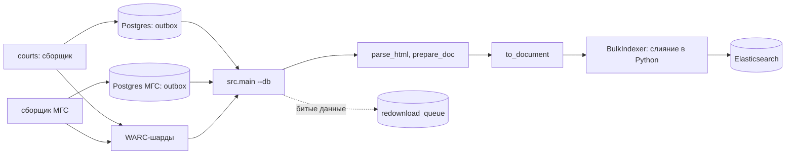

# index — индексатор судебных дел

Собирает сохранения карточек дел, которые записали сборщик [courts](../courts) и сборщик МГС (mos-gorsud.ru), в один документ индекса на дело и пишет его в Elasticsearch. Термины — в [GLOSSARY.md](GLOSSARY.md), решения — в [docs/adr/](docs/adr/).

Боевой код — Python в [src/](src/). Корневые `*.js` (`loadFromDb.js`, `parser.js`, `prepare_doc.js`, `html_to_raw.js`, `toDocument.js`), `sud_import/`, `sud_delo_mgs_*.py` и `merge_case_files_v1` — легаси или посторонние скрейперы, их не правят; Python-эквиваленты лежат в `src/`.

## Как это связано с courts

Сборщик пишет каждое сохранение в WARC-шард и кладёт строку в таблицу `outbox` своего Postgres: `warc_locator` вида `путь:смещение:длина`, `priority` (приоритетная индексация идёт по строкам с `priority > 0`), `status`. Индексатор берёт строки outbox, читает группу из двух WARC-записей (манифест и HTML), собирает документ и пишет в ES. Схема `outbox` и `redownload_queue` — в [init.sql](init.sql) (копия для тестов и локального Postgres; источник истины — courts). Сам перекачивающий воркер вне index (ADR 0003).



## Конвейер

1. **Источник** отдаёт «юниты» одной формы (`manifest_path`, `meta`, список HTML). Источники `src/main.py`:
   - `--db` — боевой: `load_from_db.poll_batch` берёт `NEW`/`FAILED` строки outbox с арендой на 5 минут (`FOR UPDATE SKIP LOCKED`, не более 5 попыток), строки с `priority` идут первыми; локаторы читаются из WARC (`rows_to_units`).
   - `--warc` — полный проход по шардам без БД (полная переиндексация).
   - `--root` — обход легаси-дерева файлов `court_cases/`, `--folders` — список манифестов оттуда, `--jsonl` — JSONL (в том числе `-` из stdin).
2. **Разбор HTML** (`parse_html.py`, для МГС — `parse_html_mgs.py`) в `ProcessPoolExecutor`.
3. **Поля** (`prepare_doc.py`): правила из `elastic_index_dict.json`.
4. **Документ** (`to_document.py`): Индексный ID, `version_ts`, тип дела по `instance_case_type_mapping.json`. Индексный ID — формула из [src/utils/case_id.py](src/utils/case_id.py), копия `build_case_id` из courts, плюс правило группы по UID карточки ([uuid_group.py](src/uuid_group.py), ADR 0001).
5. **Запись** (`bulk_indexer.py`): `mget` текущего документа, слияние в Python, близнецы по `uuid` вливаются и удаляются (ADR 0002), `appeared_at` ставится при пополнении дела (ADR 0004), затем `_bulk`.
6. **Статус**: строка outbox становится `DONE` только после подтверждения ES. Данные, которые не проиндексировать (`path_missing`, `docs_missing`, `bad_manifest_json`, `build_failed`, `sql_error`, `empty_html`), дают статус `REDOWNLOAD` и заявку в `redownload_queue` — Перекачку (ADR 0003). Неожиданные ошибки идут в `FAILED` с повтором.

На время прогона индексатор ставит индексу `refresh_interval=-1` и `number_of_replicas=0`, потом возвращает прежние значения. С `--priority-only` настройки не трогаются, а в конце делается `refresh` — так отслеживаемые карточки видны в поиске за минуты.

`src/main_s3.py` — параллельный вход для MinIO/S3 (бенчмарк): намеренно не связан с `main.py` (import-linter, см. `pyproject.toml`), общие только модули разбора и записи.

## Структура

| Путь | Что |
| --- | --- |
| `src/main.py` | боевая точка входа, все режимы источников |
| `src/load_from_db.py` | outbox: аренда, статусы, Перекачка, чтение WARC |
| `src/parse_html*.py`, `prepare_doc.py`, `to_document.py` | разбор и сборка документа |
| `src/bulk_indexer.py` | слияние, близнецы, пачки `_bulk` |
| `src/mapping_new.json` | маппинг, с которым создаётся отсутствующий индекс |
| `src/main_s3.py`, `traverse_s3.py`, `scripts/upload_to_minio.py` | путь через MinIO (бенчмарк) |
| `src/traverse.py` | обход легаси-дерева файлов |
| `scripts/index_mgs.sh` | cron-обёртка: outbox МГС в ES |
| `scripts/index_jsonl*.sh`, `index_failed.sh` | пакетная заливка JSONL(.gz) |
| `scripts/rekey_case_ids.py`, `dedup_bracket_ids.py`, `clean_stale_result.py`, `fix_hmao_region.py`, `trim_orphans.py`, `audit_subcategory.sh`, `src/dedup_whitespace.py`, `src/dump_none_ids.py`, `src/migrate_none_ids.py`, `src/fix_bad_date_reg.py` | разовые миграции и чистки уже проиндексированного: у каждого в docstring порядок запуска, сначала `--dry-run` или режим без записи |
| `src/parse_html_sx.py` | альтернативный парсер на selectolax, в `main.py` закомментирован; нужен `tests/test_parity_sx.py` |
| `tests/` | pytest; фикстуры — реальные фрагменты страниц судов, проверки по русским строкам |

Не в git и не нужны для работы: `rk.*` и `failed_paths.log` (артефакты `rekey_case_ids.py` и прогонов; `/rk.*` и `/*.log` в `.gitignore`), `court_cases/`, `node_modules/`.

## Запуск

```bash
uv sync
# боевой режим: outbox courts
uv run python -m src.main --index sudata --db --es http://HOST:9200 [--workers N]
# приоритетная индексация
uv run python -m src.main --index sudata --db --priority-only
# outbox МГС
INDEX=sudata scripts/index_mgs.sh
# полная переиндексация из WARC
uv run python -m src.main --index NEW_INDEX --warc /path/to/shards
```

Постгрес берётся из `PGHOST`, `PGPORT` (по умолчанию 8432), `PGDATABASE`, `PGUSER`, `PGPASSWORD`. ES: `--es` (по умолчанию `http://localhost:9222`), `--user`/`--pass`, `--api-key` или переменные `ES_API_KEY`, `ES_USER` + `SGMDLT_PASSWORD`; всё это читается из `.env` через `load_dotenv`, значения из окружения побеждают `.env`. Если индекса нет, он создаётся по `mapping_new.json`. Итоговая строка прогона: `=== … Indexation COMPLETED: … ===`; метрики пишутся в лог каждые 5 секунд, без сохранения.

Пути WARC из outbox — контейнерные. Индексатор подменяет префикс: `COURTS_WARC_DOCKER_ROOT` (`/app/court_warc/`, для МГС `/app/out/`) на `COURTS_WARC_ROOT` (`/home/ltdmgs/courts_warc/`); для легаси-дерева — `COURTS_FS_ROOT`. Таблицы можно переопределить через `PG_TABLE` и `PG_REDOWNLOAD_TABLE`.

`docker-compose.yml` поднимает локальные ES 8.15 (порт 9200, без безопасности) и Kibana; порты, названные в `AGENTS.md` (9222, 5615), с файлом не совпадают. `Makefile` частично устарел: цели `run` и `retry_db` вызывают удалённые Node-скрипты, `remake` ломается вместе с ними.

## Расписание

Cron-строк в репозитории нет: расписание лежит в crontab хоста. Все прогоны — пакетные задачи, а не демоны: они завершаются, когда outbox пуст, идут под `flock` и `nice -n 19` и пишут в индекс `sudata_v2` на `http://10.13.12.1:9200`. Состояние на 2026-11-15:

| Прогон | Когда | Лог |
| --- | --- | --- |
| `python -m src.main --db --workers 4` (courts) | каждые 2 ч, :30 | `~/index.log` |
| `python -m src.main --db --priority-only --workers 2` (courts) | каждые 20 мин с :07 | `~/index_prio.log` |
| `scripts/index_mgs.sh --workers 4` (МГС) | каждые 2 ч, :00 | `~/index_mgs.log` |
| `scripts/index_mgs.sh --priority-only --workers 2` (МГС) | каждые 20 мин с :14 | `~/index_mgs_prio.log` |

## Грабли

- Индекс должен пересобираться с нуля: Индексный ID не зависит от порядка индексации, но одно дело может прийти под несколькими ID — их сводят слияние близнецов и `rekey_case_ids.py`.
- Если ES не ответил на `mget` или поиск близнецов, падает вся пачка, а не пишется вслепую (ADR 0001, 0002).
- JSONL-прогон с недописанными документами завершается кодом 1, чтобы вызывающий скрипт не удалил файл.
- `merge_docs` обходит поля входящего документа: убрать из документа устаревшее значение переиндексацией нельзя, нужен скрипт по месту (пример — `clean_stale_result.py`).
- Скрипты `scripts/*.py` и `index_*.sh` содержат адрес ES `http://10.13.12.1:9200` и имя индекса `sudata` по умолчанию; `index_mgs.sh` индекс не угадывает и требует `INDEX`.

## Проверки

```bash
mise run check    # ruff, ty, deptry, import-linter, shellcheck, betterleaks, osv-scanner, jactionlint, agnix, pytest
make test         # только pytest
```

Исключения линтеров — baseline, а не образец (см. `AGENTS.md`). Задачи живут в beads репозитория courts с меткой `repo:index` ([docs/agents/issue-tracker.md](docs/agents/issue-tracker.md)).
